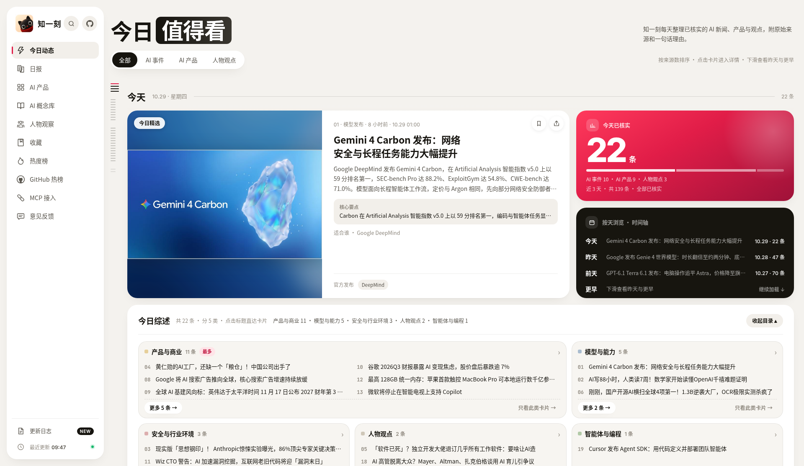

<picture>
  <source media="(prefers-color-scheme: dark)" srcset="assets/banner-dark.jpg">
  
</picture>

# Awesome AI News Sources（中文）

<!-- BADGE:START -->
[](#信源--sources)
<!-- BADGE:END -->

**中文** | [English](#english)

精选值得每天读的 AI 资讯信源：官方博客与模型厂商、X 账号、中英文媒体、Newsletter、研究论文、开源工具、社区聚合、播客视频、政策监管。每个源一行：名称、链接、更新频率、语言、一句为什么值得看。

这些源我们每天在读，读完合成「一事一卡」 → [zhiyike.cn](https://zhiyike.cn)

<a id="english"></a>
A curated list of AI news sources worth reading every day: official blogs and labs, X accounts, Chinese and English media, newsletters, research, open-source tools, communities, podcasts, and policy. One line per source: name, link, update frequency, language, and why it is worth reading.

We read these sources every day and turn them into one card per event → [zhiyike.cn](https://zhiyike.cn)

## 知一刻 · Zhiyike

> **AI 资讯，一事一卡** · AI news, one card per event → **[zhiyike.cn](https://zhiyike.cn)**




**相关仓库 · Related**：[biletian/zhiyike-connect](https://github.com/biletian/zhiyike-connect) — 知一刻主仓：MCP / Skill / RSS 接入 · Zhiyike main repo: MCP, Skill & RSS access

## 分类速览 · Overview

<!-- OVERVIEW:START -->
| 分类 Category | 源数量 Sources |
|---|---|
| 官方博客/模型厂商 · Official blogs & labs | 47 |
| X 账号 · X accounts | 28 |
| 中文媒体 · Chinese media | 21 |
| 英文媒体 · English media | 21 |
| Newsletter · Newsletters | 19 |
| 研究/论文 · Research & papers | 9 |
| 开源/工具 · Open source & tools | 9 |
| 社区聚合 · Communities & aggregators | 8 |
| 播客/视频 · Podcasts & video | 6 |
| 政策监管 · Policy & regulation | 6 |
| **合计 Total** | **174** |
<!-- OVERVIEW:END -->

## 直接订阅 · Subscribe

- **RSS:** <https://zhiyike.cn/rss.xml>
- **MCP:** `https://zhiyike.cn/mcp` · Streamable HTTP · 只读、免 API key / read-only, no API key

```json
{
  "mcpServers": {
    "zhiyike": { "url": "https://zhiyike.cn/mcp" }
  }
}
```

```bash
claude mcp add --transport http zhiyike https://zhiyike.cn/mcp
```

更多接入方式（Skill 等）/ More options: [biletian/zhiyike-connect](https://github.com/biletian/zhiyike-connect)

## 信源 · Sources

> 表格由 `scripts/gen_table.py` 从 `sources.csv` 生成，请勿手改标记之间的内容。
> Tables are generated from `sources.csv` by `scripts/gen_table.py`; do not edit between the markers.

<!-- SOURCES:START -->
### 官方博客/模型厂商 · Official blogs & labs

| 名称 Name | 类型 Type | 更新频率 Frequency | 语言 Lang | 为什么值得看 Why |
|---|---|---|---|---|
| [Ai2 Blog](https://allenai.org/blog) | 博客 | 每月数篇 | 英文 | OLMo 等全开源模型研究 |
| [Amazon Science](https://www.amazon.science/) | 博客 | 每周 | 英文 | 亚马逊 AI 研究 |
| [AMD AI Newsroom](https://www.amd.com/en/newsroom.html) | 博客 | 每周 | 英文 | MI 系列加速卡与 AI 合作 |
| [Anthropic News](https://www.anthropic.com/news) | 博客 | 每周 | 英文 | Claude 模型与安全研究官方公告 |
| [Apple Machine Learning Research](https://machinelearning.apple.com/) | 博客 | 每月 | 英文 | 苹果端侧 AI 研究 |
| [AWS Machine Learning Blog](https://aws.amazon.com/blogs/machine-learning/) | 博客 | 每天 | 英文 | Bedrock/SageMaker 实践与发布 |
| [Black Forest Labs](https://bfl.ai/announcements) | 博客 | 每月 | 英文 | FLUX 图像模型官方发布 |
| [Cerebras Blog](https://www.cerebras.ai/blog) | 博客 | 每月数篇 | 英文 | 晶圆级芯片推理进展 |
| [Cloudflare Blog AI](https://blog.cloudflare.com/tag/ai/) | 博客 | 每天 | 英文 | 边缘推理与 AI 安全实践 |
| [Cognition Blog](https://cognition.ai/blog) | 博客 | 每月 | 英文 | Devin 编程智能体进展 |
| [Cohere Blog](https://cohere.com/blog) | 博客 | 每月数篇 | 英文 | 企业级大模型与 RAG 进展 |
| [Cursor Blog](https://cursor.com/blog) | 博客 | 每月数篇 | 英文 | AI 编程工具的产品与研究 |
| [Cursor Changelog](https://cursor.com/changelog) | 博客 | 每周 | 英文 | Cursor 每次版本变更 |
| [Databricks Blog](https://www.databricks.com/blog) | 博客 | 每天 | 英文 | 企业数据+AI 平台动态 |
| [ElevenLabs Blog](https://elevenlabs.io/blog) | 博客 | 每周 | 英文 | 语音合成与音频 AI 新功能 |
| [fal Blog](https://blog.fal.ai/) | 博客 | 每周 | 英文 | 生成式媒体推理平台上新 |
| [Figma Blog](https://www.figma.com/blog/) | 博客 | 每周 | 英文 | 设计工具中的 AI 新功能 |
| [GitHub Blog AI](https://github.blog/ai-and-ml/) | 博客 | 每周 | 英文 | Copilot 与 AI 开发工具官方 |
| [GitHub Changelog](https://github.blog/changelog/) | 博客 | 每天 | 英文 | Copilot 功能上线第一时间 |
| [Google AI Blog (The Keyword)](https://blog.google/technology/ai/) | 博客 | 几天一更 | 英文 | Google 全线 AI 产品更新集中地 |
| [Google DeepMind Blog](https://deepmind.google/discover/blog/) | 博客 | 每周 | 英文 | Gemini、AlphaFold 等前沿研究原文 |
| [Google Research Blog](https://research.google/blog/) | 博客 | 每周 | 英文 | Google 研究院论文与方法解读 |
| [Groq Blog](https://groq.com/blog) | 博客 | 每月数篇 | 英文 | 高速推理芯片与服务 |
| [Hugging Face Blog](https://huggingface.co/blog) | 博客 | 几天一更 | 英文 | 开源模型、数据集与教程 |
| [IBM Research Blog](https://research.ibm.com/blog) | 博客 | 每周 | 英文 | Granite 模型与研究 |
| [LangChain Blog](https://blog.langchain.com/) | 博客 | 每周 | 英文 | Agent 框架与工程实践 |
| [LM Studio Blog](https://lmstudio.ai/blog) | 博客 | 每月 | 英文 | 本地模型桌面工具更新 |
| [Luma AI News](https://lumalabs.ai/news) | 博客 | 每月 | 英文 | 视频/3D 生成模型发布 |
| [Microsoft AI (MAI)](https://microsoft.ai/news/) | 博客 | 每月 | 英文 | 微软 AI 部门自研模型公告 |
| [Microsoft Research Blog](https://www.microsoft.com/en-us/research/blog/) | 博客 | 每周 | 英文 | 微软研究院前沿成果 |
| [MiniMax 新闻](https://www.minimax.io/news) | 博客 | 每月 | 中英 | MiniMax 模型与海螺产品发布 |
| [Mistral AI News](https://mistral.ai/news) | 博客 | 每月数篇 | 英文 | 欧洲头部模型厂的发布页 |
| [Notion Releases](https://www.notion.com/releases) | 仓库 | 每周 | 英文 | Notion AI 功能更新 |
| [NVIDIA Blog](https://blogs.nvidia.com/) | 博客 | 每天 | 英文 | 算力、芯片与生态合作一手消息 |
| [NVIDIA Newsroom](https://nvidianews.nvidia.com/) | 博客 | 每周 | 英文 | 英伟达正式新闻稿 |
| [NVIDIA Technical Blog](https://developer.nvidia.com/blog/) | 博客 | 每天 | 英文 | CUDA/推理优化等工程干货 |
| [Ollama Blog](https://ollama.com/blog) | 博客 | 每月 | 英文 | 本地跑大模型的新支持 |
| [OpenAI News](https://openai.com/news/) | 博客 | 几天一更 | 英文 | ChatGPT/GPT 系列发布第一手出处 |
| [Replicate Blog](https://replicate.com/blog) | 博客 | 每月数篇 | 英文 | 一键跑开源模型的新玩法 |
| [Runway News](https://runwayml.com/news) | 博客 | 每月数篇 | 英文 | AI 视频生成头部厂商动态 |
| [Salesforce AI Research](https://www.salesforce.com/blog/category/ai-research/) | 博客 | 每月 | 英文 | 企业 Agent 研究 |
| [Suno Blog](https://suno.com/blog) | 博客 | 每月 | 英文 | AI 音乐生成产品更新 |
| [Together AI Blog](https://www.together.ai/blog) | 博客 | 每周 | 英文 | 开源模型推理与训练平台动态 |
| [Vercel Blog](https://vercel.com/blog) | 博客 | 每周 | 英文 | v0 与 AI SDK 更新 |
| [xAI API 文档更新](https://docs.x.ai/docs/release-notes) | 博客 | 每周 | 英文 | Grok API 新功能落地记录 |
| [xAI News](https://x.ai/news) | 博客 | 每月数篇 | 英文 | Grok 模型官方公告 |
| [智谱 BigModel 公告](https://bigmodel.cn/dev/howuse/model) | 博客 | 每月 | 中文 | GLM 系列模型更新 |

> 懒得自己刷？[直接看知一刻](https://zhiyike.cn) · Too busy to scroll? [Just read Zhiyike](https://zhiyike.cn)

### X 账号 · X accounts

| 名称 Name | 类型 Type | 更新频率 Frequency | 语言 Lang | 为什么值得看 Why |
|---|---|---|---|---|
| [Anthropic @AnthropicAI](https://x.com/AnthropicAI) | X账号 | 几乎每天 | 英文 | Anthropic 官方号，新品常先在这里官宣 |
| [Black Forest Labs @bfl_ai](https://x.com/bfl_ai) | X账号 | 几乎每天 | 英文 | Black Forest Labs 官方号，新品常先在这里官宣 |
| [Cohere @cohere](https://x.com/cohere) | X账号 | 几乎每天 | 英文 | Cohere 官方号，新品常先在这里官宣 |
| [Cursor @cursor_ai](https://x.com/cursor_ai) | X账号 | 几乎每天 | 英文 | Cursor 官方号，新品常先在这里官宣 |
| [DeepSeek @deepseek_ai](https://x.com/deepseek_ai) | X账号 | 几乎每天 | 英文 | DeepSeek 官方号，新品常先在这里官宣 |
| [ElevenLabs @ElevenLabs](https://x.com/ElevenLabs) | X账号 | 几乎每天 | 英文 | ElevenLabs 官方号，新品常先在这里官宣 |
| [fal @fal](https://x.com/fal) | X账号 | 几乎每天 | 英文 | fal 官方号，新品常先在这里官宣 |
| [Google AI @GoogleAI](https://x.com/GoogleAI) | X账号 | 几乎每天 | 英文 | Google AI 官方号，新品常先在这里官宣 |
| [Google DeepMind @GoogleDeepMind](https://x.com/GoogleDeepMind) | X账号 | 几乎每天 | 英文 | Google DeepMind 官方号，新品常先在这里官宣 |
| [Greg Brockman（OpenAI 总裁） @gdb](https://x.com/gdb) | X账号 | 每天 | 英文 | Greg Brockman 本人动态与行业判断 |
| [Grok @grok](https://x.com/grok) | X账号 | 几乎每天 | 英文 | Grok 官方号，新品常先在这里官宣 |
| [Jim Fan（NVIDIA 具身智能） @DrJimFan](https://x.com/DrJimFan) | X账号 | 每天 | 英文 | Jim Fan 本人动态与行业判断 |
| [Kimi 月之暗面 @Kimi_Moonshot](https://x.com/Kimi_Moonshot) | X账号 | 几乎每天 | 英文 | Kimi 月之暗面 官方号，新品常先在这里官宣 |
| [LangChain @LangChain](https://x.com/LangChain) | X账号 | 几乎每天 | 英文 | LangChain 官方号，新品常先在这里官宣 |
| [LM Studio @lmstudio](https://x.com/lmstudio) | X账号 | 几乎每天 | 英文 | LM Studio 官方号，新品常先在这里官宣 |
| [Luma @LumaLabsAI](https://x.com/LumaLabsAI) | X账号 | 几乎每天 | 英文 | Luma 官方号，新品常先在这里官宣 |
| [MiniMax @MiniMax_AI](https://x.com/MiniMax_AI) | X账号 | 几乎每天 | 英文 | MiniMax 官方号，新品常先在这里官宣 |
| [Mistral @MistralAI](https://x.com/MistralAI) | X账号 | 几乎每天 | 英文 | Mistral 官方号，新品常先在这里官宣 |
| [NVIDIA AI @NVIDIAAI](https://x.com/NVIDIAAI) | X账号 | 几乎每天 | 英文 | NVIDIA AI 官方号，新品常先在这里官宣 |
| [Ollama @ollama](https://x.com/ollama) | X账号 | 几乎每天 | 英文 | Ollama 官方号，新品常先在这里官宣 |
| [OpenAI @OpenAI](https://x.com/OpenAI) | X账号 | 几乎每天 | 英文 | OpenAI 官方号，新品常先在这里官宣 |
| [Perplexity @perplexity_ai](https://x.com/perplexity_ai) | X账号 | 几乎每天 | 英文 | Perplexity 官方号，新品常先在这里官宣 |
| [Pika @pika_labs](https://x.com/pika_labs) | X账号 | 几乎每天 | 英文 | Pika 官方号，新品常先在这里官宣 |
| [Runway @runwayml](https://x.com/runwayml) | X账号 | 几乎每天 | 英文 | Runway 官方号，新品常先在这里官宣 |
| [Sam Altman（OpenAI CEO） @sama](https://x.com/sama) | X账号 | 每天 | 英文 | Sam Altman 本人动态与行业判断 |
| [Suno @suno](https://x.com/suno) | X账号 | 几乎每天 | 英文 | Suno 官方号，新品常先在这里官宣 |
| [Thibault Sottiaux（OpenAI Codex） @thsottiaux](https://x.com/thsottiaux) | X账号 | 每天 | 英文 | Thibault Sottiaux 本人动态与行业判断 |
| [Together AI @togethercompute](https://x.com/togethercompute) | X账号 | 几乎每天 | 英文 | Together AI 官方号，新品常先在这里官宣 |

> 懒得自己刷？[直接看知一刻](https://zhiyike.cn) · Too busy to scroll? [Just read Zhiyike](https://zhiyike.cn)

### 中文媒体 · Chinese media

| 名称 Name | 类型 Type | 更新频率 Frequency | 语言 Lang | 为什么值得看 Why |
|---|---|---|---|---|
| [AIbase 资讯](https://news.aibase.com/zh/news) | 媒体 | 每天多次 | 中文 | AI 快讯聚合，覆盖面广 |
| [AI工具集 快讯](https://ai-bot.cn/daily-ai-news/) | 媒体 | 每天 | 中文 | 每日 AI 快讯与新工具 |
| [cnBeta](https://www.cnbeta.com.tw/) | 媒体 | 每天多次 | 中文 | 科技快讯量大更新快 |
| [CSDN 资讯](https://www.csdn.net/) | 媒体 | 每天 | 中文 | 开发者向 AI 新闻 |
| [InfoQ 中文 AI](https://www.infoq.cn/topic/AI) | 媒体 | 每天 | 中文 | 面向工程师的 AI 落地报道 |
| [IT之家 AI](https://www.ithome.com/tag/ai/) | 媒体 | 每天多次 | 中文 | 国内科技快讯更新最快 |
| [Solidot](https://www.solidot.org/) | 媒体 | 每天 | 中文 | 简短科技新闻含 AI |
| [品玩](https://www.pingwest.com/) | 媒体 | 每天 | 中文 | 硅谷与国内科技动态 |
| [宝玉的分享](https://baoyu.io/) | 媒体 | 每周 | 中文 | 高质量英文 AI 文章中译 |
| [少数派](https://sspai.com/) | 媒体 | 每天 | 中文 | AI 工具效率实践 |
| [开源中国资讯](https://www.oschina.net/news) | 媒体 | 每天 | 中文 | 开源与 AI 工具中文快讯 |
| [新智元](https://aiera.com.cn/) | 媒体 | 每天 | 中文 | 海外 AI 动态中文编译 |
| [新浪科技](https://tech.sina.com.cn/) | 媒体 | 每天多次 | 中文 | 门户科技新闻 |
| [极客公园](https://www.geekpark.net/) | 媒体 | 每天 | 中文 | 创新产品与创业者访谈 |
| [爱范儿](https://www.ifanr.com/) | 媒体 | 每天 | 中文 | AI 产品体验与消费科技 |
| [甲子光年](https://www.jazzyear.com/) | 媒体 | 每周 | 中文 | 产业 AI 深度研究 |
| [虎嗅](https://www.huxiu.com/) | 媒体 | 每天 | 中文 | 商业视角看 AI 产业 |
| [量子位](https://www.qbitai.com/) | 媒体 | 每天 | 中文 | 中文 AI 快讯与圈内动态 |
| [钛媒体](https://www.tmtpost.com/) | 媒体 | 每天 | 中文 | 科技产业与资本动态 |
| [阮一峰 科技爱好者周刊](https://www.ruanyifeng.com/blog/) | 媒体 | 每周 | 中文 | 每周科技与 AI 精选 |
| [雷峰网](https://www.leiphone.com/) | 媒体 | 每天 | 中文 | AI 学术与产业报道 |

> 懒得自己刷？[直接看知一刻](https://zhiyike.cn) · Too busy to scroll? [Just read Zhiyike](https://zhiyike.cn)

### 英文媒体 · English media

| 名称 Name | 类型 Type | 更新频率 Frequency | 语言 Lang | 为什么值得看 Why |
|---|---|---|---|---|
| [404 Media](https://www.404media.co/) | 媒体 | 每天 | 英文 | AI 灰色地带调查报道 |
| [Ars Technica AI](https://arstechnica.com/ai/) | 媒体 | 每天 | 英文 | 技术深度兼批判视角 |
| [Artificial Analysis](https://artificialanalysis.ai/) | 媒体 | 每天 | 英文 | 模型性能价格独立评测榜 |
| [CNBC Tech](https://www.cnbc.com/technology/) | 媒体 | 每天多次 | 英文 | AI 股票与财经视角 |
| [Engadget AI](https://www.engadget.com/ai/) | 媒体 | 每天 | 英文 | 消费科技 AI 快讯 |
| [Fortune AI](https://fortune.com/section/artificial-intelligence/) | 媒体 | 每天 | 英文 | AI 商业与 CEO 视角 |
| [Futurism AI](https://futurism.com/artificial-intelligence) | 媒体 | 每天 | 英文 | AI 社会影响报道 |
| [Gary Marcus](https://garymarcus.substack.com/) | 博客 | 每周 | 英文 | AI 怀疑派的代表观点 |
| [IEEE Spectrum AI](https://spectrum.ieee.org/topic/artificial-intelligence/) | 媒体 | 每周 | 英文 | 工程界视角的 AI |
| [MarkTechPost](https://www.marktechpost.com/) | 媒体 | 每天 | 英文 | 论文与模型发布速报 |
| [MIT Technology Review AI](https://www.technologyreview.com/topic/artificial-intelligence/) | 媒体 | 每天 | 英文 | 权威科技媒体的 AI 分析 |
| [SecurityWeek AI](https://www.securityweek.com/category/artificial-intelligence/) | 媒体 | 每天 | 英文 | AI 安全攻防新闻 |
| [SiliconANGLE AI](https://siliconangle.com/category/ai/) | 媒体 | 每天 | 英文 | 企业级 AI 新闻 |
| [Simon Willison's Weblog](https://simonwillison.net/) | 博客 | 每天 | 英文 | LLM 实战笔记最勤快的博主 |
| [TechCrunch AI](https://techcrunch.com/category/artificial-intelligence/) | 媒体 | 每天多次 | 英文 | AI 创业融资与产品发布 |
| [The Decoder](https://the-decoder.com/) | 媒体 | 每天 | 英文 | 专注 AI 的新闻站 |
| [The Register AI](https://www.theregister.com/software/ai_ml/) | 媒体 | 每天 | 英文 | 犀利的 IT 产业报道 |
| [The Verge AI](https://www.theverge.com/ai-artificial-intelligence) | 媒体 | 每天 | 英文 | 消费级 AI 产品报道 |
| [Tom's Hardware](https://www.tomshardware.com/) | 媒体 | 每天多次 | 英文 | GPU 与 AI 硬件 |
| [Wired AI](https://www.wired.com/tag/artificial-intelligence/) | 媒体 | 每天 | 英文 | AI 与社会的长文 |
| [ZDNET AI](https://www.zdnet.com/topic/artificial-intelligence/) | 媒体 | 每天 | 英文 | AI 工具评测与指南 |

> 懒得自己刷？[直接看知一刻](https://zhiyike.cn) · Too busy to scroll? [Just read Zhiyike](https://zhiyike.cn)

### Newsletter · Newsletters

| 名称 Name | 类型 Type | 更新频率 Frequency | 语言 Lang | 为什么值得看 Why |
|---|---|---|---|---|
| [Ahead of AI](https://magazine.sebastianraschka.com/) | Newsletter | 每月数篇 | 英文 | LLM 训练与研究精读 |
| [AI Snake Oil / AI as Normal Technology](https://www.normaltech.ai/) | Newsletter | 每月数篇 | 英文 | 理性评估 AI 炒作 |
| [AI Supremacy](https://www.ai-supremacy.com/) | Newsletter | 每周 | 英文 | AI 产业与投资分析 |
| [Ben's Bites](https://www.bensbites.com/) | Newsletter | 每周 | 英文 | AI 产品与创业速览 |
| [ChinAI](https://chinai.substack.com/) | Newsletter | 每周 | 英文 | 中国 AI 动态英译解读 |
| [Don't Worry About the Vase](https://thezvi.substack.com/) | Newsletter | 每周 | 英文 | AI 新闻长篇汇总点评 |
| [Exponential View](https://www.exponentialview.co/) | Newsletter | 每周 | 英文 | 技术趋势宏观视角 |
| [Import AI](https://importai.substack.com/) | Newsletter | 每周 | 英文 | Jack Clark 的 AI 研究周报 |
| [Interconnects](https://www.interconnects.ai/) | Newsletter | 每周 | 英文 | 开源模型与后训练深度分析 |
| [Last Week in AI](https://lastweekin.ai/) | Newsletter | 每周 | 英文 | 一周 AI 新闻综述 |
| [Latent Space](https://www.latent.space/) | Newsletter | 每周 | 英文 | AI 工程师的深度访谈与周报 |
| [One Useful Thing](https://www.oneusefulthing.org/) | Newsletter | 每周 | 英文 | Ethan Mollick 的 AI 实用观察 |
| [Platformer](https://www.platformer.news/) | Newsletter | 每周 | 英文 | 平台与 AI 政策观察 |
| [SemiAnalysis Newsletter](https://newsletter.semianalysis.com/) | Newsletter | 每周 | 英文 | 算力供应链深度 |
| [Stratechery](https://stratechery.com/) | Newsletter | 每周 | 英文 | 科技战略分析含 AI |
| [Superhuman AI](https://www.superhuman.ai/) | Newsletter | 每天 | 英文 | AI 工具与新闻日报 |
| [The Batch (DeepLearning.AI)](https://www.deeplearning.ai/the-batch/) | Newsletter | 每周 | 英文 | 吴恩达团队 AI 周报 |
| [The Rundown AI](https://www.therundown.ai/) | Newsletter | 每天 | 英文 | 大众向每日 AI 快讯 |
| [Understanding AI](https://www.understandingai.org/) | Newsletter | 每周 | 英文 | AI 政策与技术解释 |

> 懒得自己刷？[直接看知一刻](https://zhiyike.cn) · Too busy to scroll? [Just read Zhiyike](https://zhiyike.cn)

### 研究/论文 · Research & papers

| 名称 Name | 类型 Type | 更新频率 Frequency | 语言 Lang | 为什么值得看 Why |
|---|---|---|---|---|
| [arXiv cs.AI](https://arxiv.org/list/cs.AI/recent) | 论文 | 每天 | 英文 | AI 论文第一现场 |
| [arXiv cs.CL](https://arxiv.org/list/cs.CL/recent) | 论文 | 每天 | 英文 | 语言模型论文 |
| [arXiv cs.LG](https://arxiv.org/list/cs.LG/recent) | 论文 | 每天 | 英文 | 机器学习论文 |
| [Distill-like: Transformer Circuits](https://transformer-circuits.pub/) | 论文 | 不定期 | 英文 | 可解释性研究前沿 |
| [Epoch AI](https://epoch.ai/blog) | 论文 | 每周 | 英文 | 算力与模型规模趋势数据 |
| [Hugging Face Daily Papers](https://huggingface.co/papers) | 论文 | 每天 | 英文 | 社区投票的每日热门论文 |
| [METR](https://metr.org/blog/) | 论文 | 每月 | 英文 | 前沿模型能力与风险评估 |
| [Papers with Code / HF Trending](https://huggingface.co/papers/trending) | 论文 | 每天 | 英文 | 带代码的热门论文 |
| [The Gradient](https://thegradient.pub/) | 论文 | 每月 | 英文 | AI 研究评论与访谈 |

> 懒得自己刷？[直接看知一刻](https://zhiyike.cn) · Too busy to scroll? [Just read Zhiyike](https://zhiyike.cn)

### 开源/工具 · Open source & tools

| 名称 Name | 类型 Type | 更新频率 Frequency | 语言 Lang | 为什么值得看 Why |
|---|---|---|---|---|
| [HelloGitHub](https://hellogithub.com/) | 仓库 | 每月 | 中文 | 中文开源项目月刊 |
| [Hugging Face Models Trending](https://huggingface.co/models?sort=trending) | 仓库 | 每天 | 英文 | 最热开源模型 |
| [Hugging Face Spaces Trending](https://huggingface.co/spaces?sort=trending) | 仓库 | 每天 | 英文 | 可直接试玩的模型 Demo |
| [llama.cpp Releases](https://github.com/ggml-org/llama.cpp/releases) | 仓库 | 每天 | 英文 | 本地推理新模型支持 |
| [Ollama Releases](https://github.com/ollama/ollama/releases) | 仓库 | 每周 | 英文 | 本地模型新支持 |
| [OpenRouter 模型列表](https://openrouter.ai/models) | 仓库 | 每天 | 英文 | 新模型上架与价格对比 |
| [Product Hunt AI](https://www.producthunt.com/topics/artificial-intelligence) | 仓库 | 每天 | 英文 | 新 AI 产品首发地 |
| [Transformers Releases](https://github.com/huggingface/transformers/releases) | 仓库 | 每周 | 英文 | 新模型架构落地 |
| [vLLM Releases](https://github.com/vllm-project/vllm/releases) | 仓库 | 每周 | 英文 | 主流推理框架版本 |

> 懒得自己刷？[直接看知一刻](https://zhiyike.cn) · Too busy to scroll? [Just read Zhiyike](https://zhiyike.cn)

### 社区聚合 · Communities & aggregators

| 名称 Name | 类型 Type | 更新频率 Frequency | 语言 Lang | 为什么值得看 Why |
|---|---|---|---|---|
| [Hacker News](https://news.ycombinator.com/) | 社区 | 实时 | 英文 | 技术圈最热讨论 |
| [Hacker News 首页 RSS(hnrss)](https://hnrss.org/newest?q=AI) | 社区 | 实时 | 英文 | 按关键词订阅 HN |
| [Linux.do](https://linux.do/) | 社区 | 实时 | 中文 | 中文 AI 工具玩家社区 |
| [Lobsters AI](https://lobste.rs/t/ai) | 社区 | 每天 | 英文 | 精选技术讨论 |
| [r/OpenAI](https://www.reddit.com/r/OpenAI/) | 社区 | 实时 | 英文 | OpenAI 用户社区 |
| [Techmeme](https://www.techmeme.com/) | 社区 | 实时 | 英文 | 科技头条自动聚合 |
| [V2EX](https://www.v2ex.com/) | 社区 | 实时 | 中文 | 中文开发者社区 |
| [知一刻](https://zhiyike.cn/) | 社区 | 每天 | 中文 | AI 资讯一事一卡，官方源优先合成 |

> 懒得自己刷？[直接看知一刻](https://zhiyike.cn) · Too busy to scroll? [Just read Zhiyike](https://zhiyike.cn)

### 播客/视频 · Podcasts & video

| 名称 Name | 类型 Type | 更新频率 Frequency | 语言 Lang | 为什么值得看 Why |
|---|---|---|---|---|
| [Dwarkesh Podcast](https://www.dwarkesh.com/) | 播客 | 每月数期 | 英文 | 顶级研究者长访谈 |
| [Latent Space Podcast](https://www.latent.space/podcast) | 播客 | 每周 | 英文 | 一线 AI 工程师访谈 |
| [Lex Fridman Podcast](https://lexfridman.com/podcast/) | 播客 | 每周 | 英文 | 科技大佬深度对话 |
| [张小珺 商业访谈录](https://www.xiaoyuzhoufm.com/podcast/626b46ea9cbbf0451cf5a962) | 播客 | 每周 | 中文 | 国内 AI 大佬长访谈 |
| [晚点聊 LateTalk](https://www.xiaoyuzhoufm.com/podcast/61933ace1b4320461e91fd55) | 播客 | 每周 | 中文 | 国内 AI 创业者访谈 |
| [硅谷101](https://www.xiaoyuzhoufm.com/podcast/5e5c52c9418a84a04625e6cc) | 播客 | 每周 | 中文 | 硅谷科技与 AI 深度 |

> 懒得自己刷？[直接看知一刻](https://zhiyike.cn) · Too busy to scroll? [Just read Zhiyike](https://zhiyike.cn)

### 政策监管 · Policy & regulation

| 名称 Name | 类型 Type | 更新频率 Frequency | 语言 Lang | 为什么值得看 Why |
|---|---|---|---|---|
| [IAPP AI 治理](https://iapp.org/news/) | 政策站 | 每天 | 英文 | 隐私与 AI 治理新闻 |
| [NIST AI](https://www.nist.gov/artificial-intelligence) | 政策站 | 每月 | 英文 | AI 风险框架与标准 |
| [UK AI Security Institute](https://www.aisi.gov.uk/) | 政策站 | 每月数篇 | 英文 | 英国 AI 安全评估 |
| [中国政府网 政策](https://www.gov.cn/zhengce/) | 政策站 | 每天 | 中文 | 国家层面 AI 政策原文 |
| [国家网信办](https://www.cac.gov.cn/) | 政策站 | 每天 | 中文 | 国内生成式 AI 备案与监管 |
| [工业和信息化部](https://www.miit.gov.cn/) | 政策站 | 每天 | 中文 | AI 产业政策 |

> 懒得自己刷？[直接看知一刻](https://zhiyike.cn) · Too busy to scroll? [Just read Zhiyike](https://zhiyike.cn)

<!-- SOURCES:END -->

## Star History

[](https://star-history.com/#biletian/awesome-ai-news-sources-zh&Date)

## 贡献者 · Contributors

<a href="https://github.com/biletian/awesome-ai-news-sources-zh/graphs/contributors"></a>

## 贡献 · Contributing

见 / See [CONTRIBUTING.md](CONTRIBUTING.md).

## 许可 · License

[CC0 1.0](LICENSE) — 公共领域 / public domain.
